

# Gini — The Assistant

#### Talk. Build. Automate. Innovate.

### Your smart, friendly, universal AI assistant.

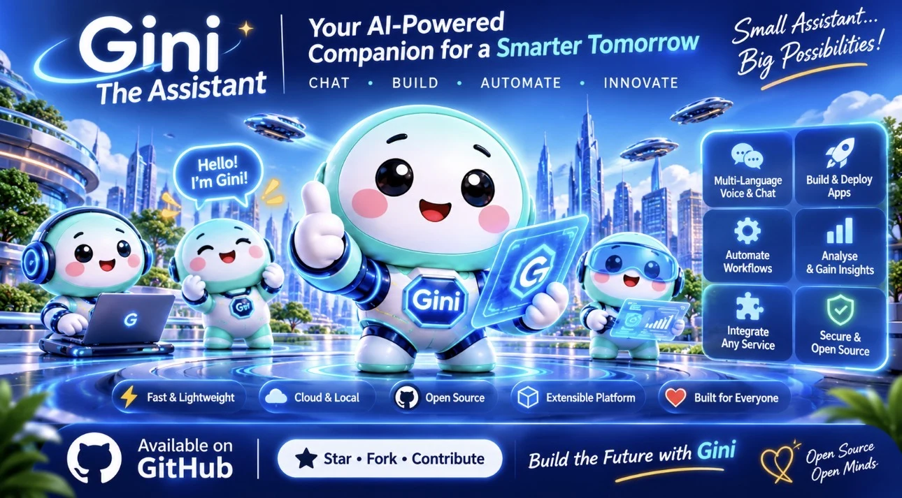

**Say hello to the assistant who actually talks back. Gini listens, answers in your language, walks you through every screen, and gets things done. The same friendly face and voice in every IshervonsAI product, or on its own on your computer. Early-access beta.**

 

[-111827?style=for-the-badge&labelColor=070707)](https://github.com/IshervonsAI/Gini/releases/latest/download/gini-darwin-arm64)
[-374151?style=for-the-badge&labelColor=070707)](https://github.com/IshervonsAI/Gini/releases/latest/download/gini-darwin-amd64)

[latest release](https://github.com/IshervonsAI/Gini/releases/latest) · [all releases](https://github.com/IshervonsAI/Gini/releases) · [report a problem](https://github.com/IshervonsAI/Gini/issues/new/choose)

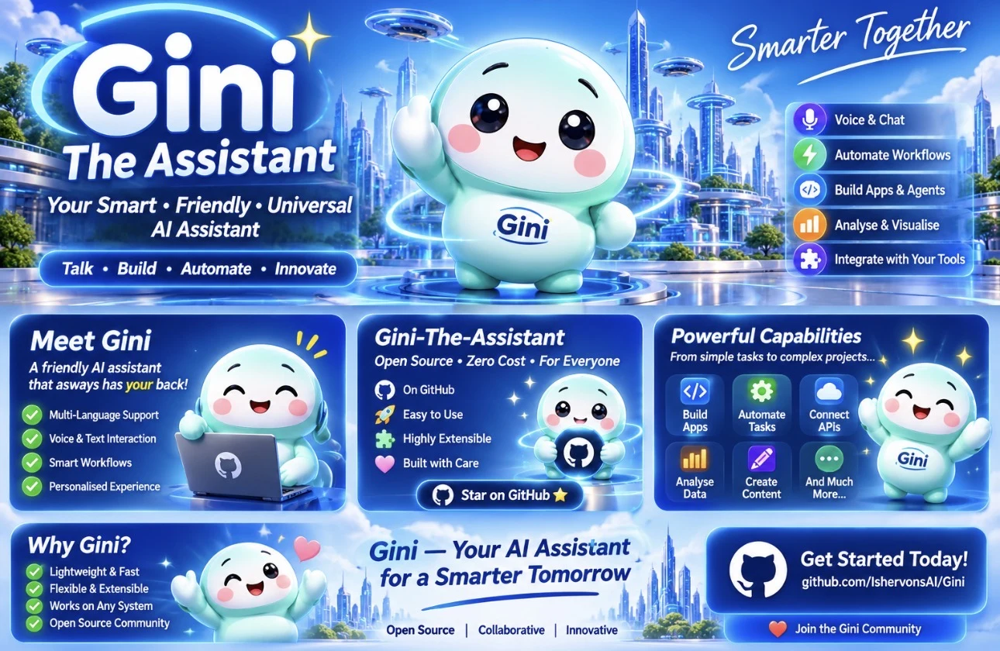

---

## Meet Gini

Gini is the small, cheerful assistant who lives in your IshervonsAI products. Ask a question out loud and she answers out loud. Get stuck on a screen and she walks over to the field and explains it. Hand her a document and she reads it, shows where every number came from, and prepares the next step for you to approve.

No manuals to read first. Just say what you need.

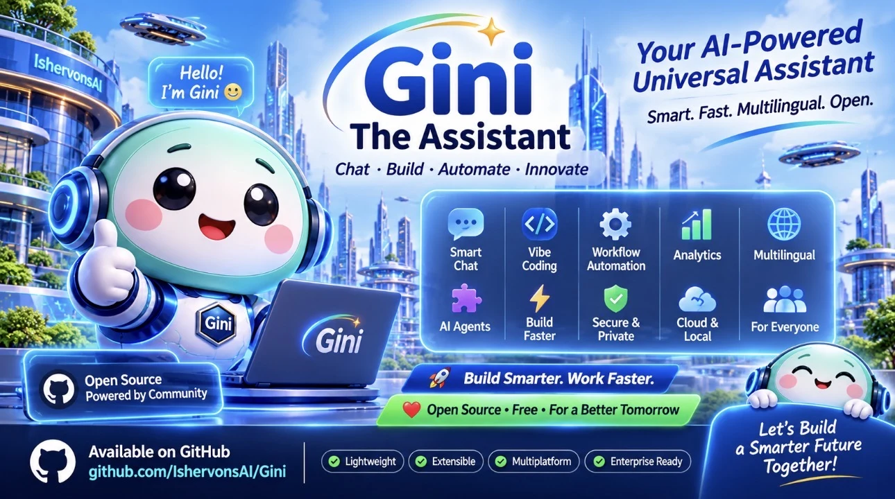

## What Gini does

| | |
|---|---|
| 🌐 **Multilingual voice & chat** | Speaks and listens in a registry of 70 languages. Understanding, translation, speaking and screen switching are reported separately, each as tested, available, degraded or unavailable. |
| 🧠 **AI agents & intelligence** | Answers "what is going on" from the product's own status, routes a task to the agent that fits (asking you first), and suggests a new capability when none fits. |
| 💻 **Build apps and software** | Inside IVC, Gini hands your request to the team that plans, builds and tests it. On its own, Gini prepares the task and the product's agents do the work. |
| ⚡ **Automate workflows** | Prepares a record from speech or a document. Creating a lead or an invoice asks you to confirm; payments, deletions and permission changes are never automatic. |
| 🔗 **Integrate your tools** | A product adds Gini with one call and gets the voice, languages, field help, keys, roles, documents and task routing, with no other work. |
| 📊 **Analyse & visualise** | Reads text, CSV, JSON, XML, HTML, email, Word, Excel and PowerPoint files, and shows where every value came from. PDF, pictures, audio, video and older Office files use optional readers. |
| 🔐 **Security & privacy** | A key pasted into the chat is recognised before any AI sees it, stored securely, removed from the chat and shown back masked. Every consent is recorded and can be withdrawn. Nothing runs while Gini is idle. |
| ☁️ **Cloud and local flexibility** | Speech engines run on your own computer, best one first, falling back step by step to the browser's voice and then to text. Gini asks before using any online service. |
| ❤️ **Open source, built for everyone** | Profiles for hearing, speech, motor, visual, cognitive and reduced-motion needs; a soft, friendly voice you can change; your own recorded voice with your consent. |

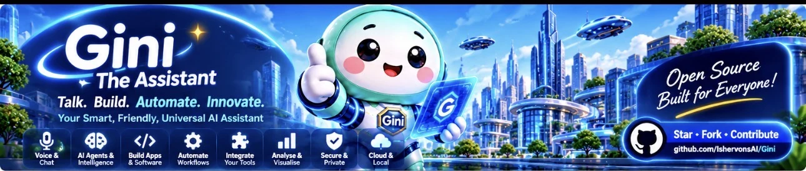

⭐ **Star · Fork · Contribute** — ideas and problems are welcome in [Issues](https://github.com/IshervonsAI/Gini/issues/new/choose).

## Why you will want her on your computer

* **She speaks your language.** Seventy languages, and she tells you honestly which ones she can speak, understand or only translate on your computer.
* **She listens while she talks.** Interrupt her at any moment and she stops the instant you start.
* **She keeps your secrets.** Paste a key into the chat and she hides it before any AI can see it.
* **She works on a small computer.** Two gigabytes is enough for text and the browser's voice; more memory simply gives her a more natural voice.
* **She is easy on everyone.** Profiles for hearing, speech, motor, visual, cognitive and reduced-motion needs are built in.

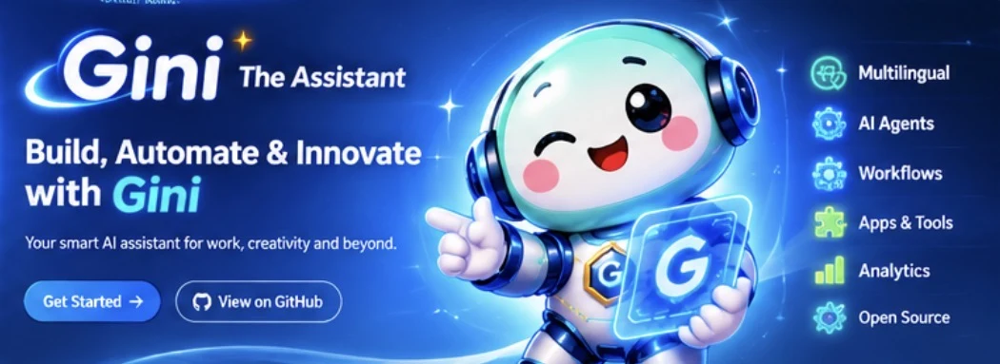

## One look, one voice

Gini is a brand in itself. It is the same round, mint-green, smiling face with the same moods (talking, thinking, listening, happy), the same walking mascot and bubble tips, and the same soft, high, friendly voice in every product. The look and the voice live in one place in the module, so every product that adds Gini shows and speaks the same Gini. A person's own recorded voice is the only thing that changes how she sounds.

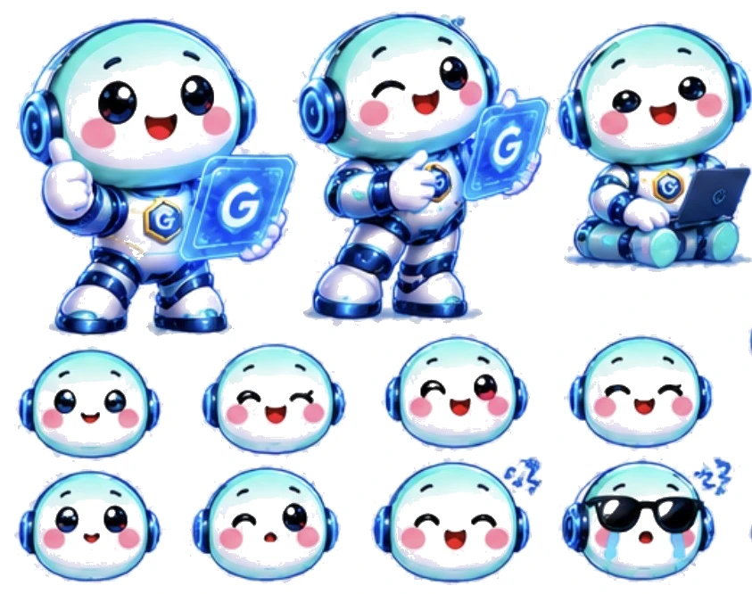

 

She waves hello, flies off to fetch an answer, searches your documents with a magnifying glass, and guards your keys with a shield. Wherever you meet her, she is recognisably Gini.

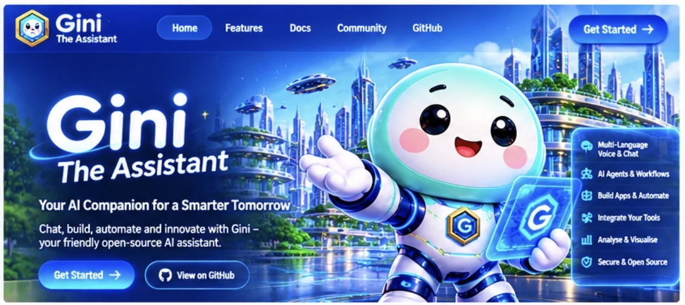

## Get started

**Gini on its own.** Download the program for your computer above, run it, and it opens in your browser with a sign-in page. The first visit creates the owner account; the owner or an administrator adds other people. Passwords are stored only as salted hashes, sessions expire, and repeated wrong passwords are slowed down.

**Gini inside a product.** IVC and the other IshervonsAI products already include Gini. Open any screen and click the face, or say what you need.

The standalone program does not install the speech engines. Install the ones you want from the list below; Gini checks that each works before using it, and says plainly when one is missing.

**A model of your own, when Gini stands alone.** Without an AI model Gini still handles screens, fields, languages, keys, documents and speech. To answer open questions and translate, the owner can paste the key of a provider that offers a no-cost allowance. Gini suggests Gemini (Google AI Studio), NVIDIA (build.nvidia.com) and Nous (Nous Portal), shows the key page and the steps for each, checks the key, and keeps it encrypted on the computer. Questions then go to that provider under its own terms, and the size of any allowance is set by the provider and can change.

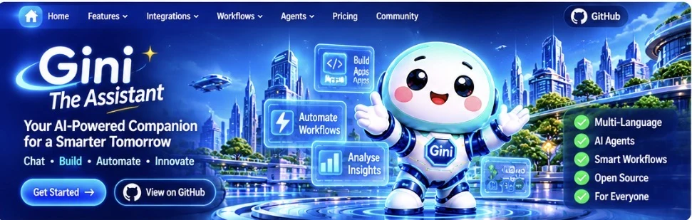

## Computers

| Memory | What Gini does |
|---|---|
| 2 GB | Text, the browser's voice, basic switching and settings. Heavy speech engines are off. |
| 3 to 4 GB | Light local speech where it fits. |
| 4 to 9 GB | Fuller local speech when resources allow. |
| 10 GB and more | The most natural voice, after a check of available memory and load. |

Each step is checked on the computer before it is used.

## Adding Gini to another product

A product calls `Mount` once, with its own sign-in, and wraps its pages with `Inject`. It then has the walking mascot, voice, languages, field help, keys, roles, documents, task routing, your own voice and the owner page. The module is written for IshervonsAI products and is not offered separately yet.

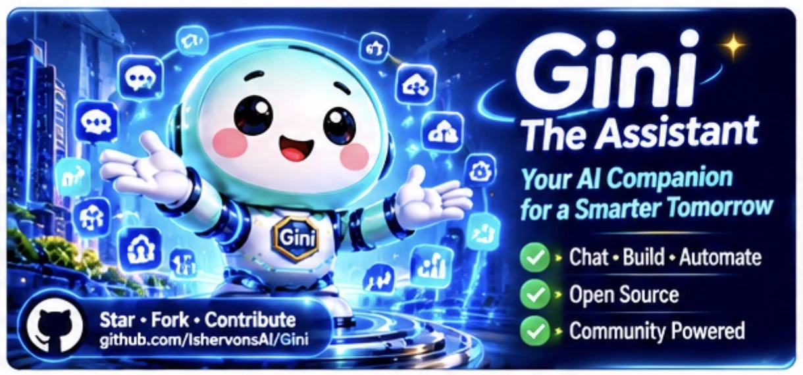

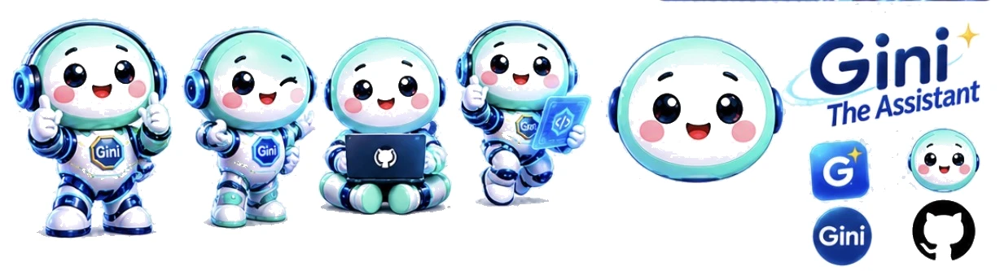

## Software Gini uses, and its licences

Gini runs each of these on your own computer and ships none of their files. You install them, and each stays under its own licence.

| Software | What Gini uses it for | Licence |
|---|---|---|
| OmniVoice | First choice for speaking, and for speaking in a voice you recorded yourself, in many languages | Code Apache-2.0. The trained model is released for non-commercial use (CC-BY-NC) |
| Kokoro (ONNX) | Second choice for speaking, 8 languages | Apache-2.0 |
| Piper | Third choice for speaking, one voice file per language | Program GPL-3.0, run as a separate program. Each voice file has its own licence |
| Whisper, through faster-whisper | Understanding speech, and reading the speech in audio and video files | MIT |
| openWakeWord | Optional hands-free wake words in the IVC voice kit | Code Apache-2.0. The ready-made wake word models are CC BY-NC-SA 4.0 (non-commercial) |
| Silero VAD | Finding speech in sound | MIT |
| Gemini, NVIDIA and Nous APIs | Optional model for open questions, only after the owner pastes a key | The provider's own terms |
| Poppler, Tesseract, FFmpeg, LibreOffice | Optional readers for PDF files, pictures, video and older Office files | Their own open-source licences |

If those engines are not available, Gini speaks with your browser's own voice and then falls back to text. The full licence list is in [NOTICE.md](NOTICE.md).

### Included at no extra charge

These speech and reading features are included with IshervonsAI products for our customers. Setup and configuration are done for you and are not billed. The speech models named above carry non-commercial terms, so this release is for use that is not sold. Before any paid use, the owner must obtain permission from the model authors or switch those engines off; Gini's engine page shows which engines carry such terms.

## Not in this beta

Telephone calls, tests on real 2 GB, 4 GB and 6 GB computers, and review of every language by native speakers are not part of this release.

## Feedback, problems and security

* **Feedback:** tell Gini "send feedback", or write to feedback@ishervonsai.eu.org.
* **A problem:** open an issue here (**Issues → New issue → Bug report**). Never paste keys or passwords.
* **A security problem:** do not open a public issue; see [SECURITY.md](SECURITY.md).

## Thank you

If Gini helps you, a ⭐ on this page means a lot to our small team: it helps others find us. Entirely up to you, and thank you for testing.

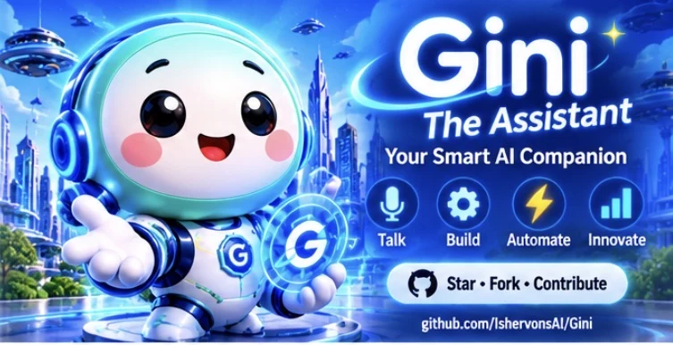

**Gini — The Assistant** · Talk · Build · Automate · Innovate

## Licence

Copyright (c) IshervonsAI. All rights reserved. Gini is proprietary software, licensed, not sold. Gini's own source code is kept in a private repository; the third-party software above stays under its own licences. Notices: [NOTICE.md](NOTICE.md). For licensing questions, use Issues.
